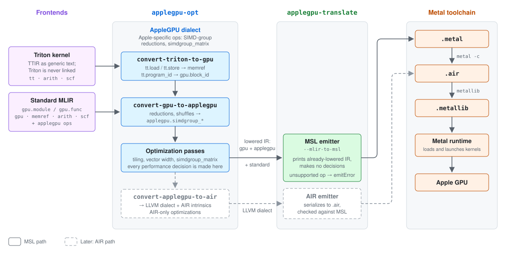

# AppleGPU: An MLIR Dialect and Backend for Apple GPUs

AppleGPU is an out-of-tree [MLIR](https://mlir.llvm.org/) dialect and backend for Apple GPUs. Upstream MLIR supports NVIDIA, AMD and Intel GPUs through dedicated dialects, but has no equivalent for Apple silicon. This project aims to provide one: a reusable backend that any MLIR-based compiler can target, exposing Apple-specific features such as SIMD-group operations and `simdgroup_matrix`.

It provides two tools: `applegpu-opt`, which runs the lowering and optimization passes, and `applegpu-translate`, which emits Metal Shading Language (MSL).

## Why a separate dialect

- **No direct path today:** MLIR reaches Apple GPUs only indirectly, through SPIR-V and a translator, and upstream Triton has no Apple backend.
- **Apple-specific operations:** SIMD-group operations and `simdgroup_matrix` need their own ops, as NVIDIA's do in NVGPU.
- **Decisions in passes:** Apple-specific choices live in the IR, so MSL and AIR get the same optimizations.
- **One target for every frontend:** Triton and standard MLIR lower to the same operations.
- **Learning MLIR:** building a dialect, its passes and its emitters end to end is how I am learning MLIR.

## Design



Triton and standard MLIR share the same dialect, passes and emitters. Standard MLIR is lowered by `applegpu-opt`. A Triton kernel goes through Triton's own target-independent layout passes in Triton's process, together with a Triton plugin of ours: it gives matrix multiplications Apple's `simdgroup_matrix` layout and lowers the kernel to per-thread `applegpu` IR, using Triton's own analyses. The plugin then runs our passes and MSL emitter in the same process, so a Triton kernel compiles without a subprocess, and our tools never link Triton. Triton support is optional and off unless you ask for it; without it, the only trace of Triton is the LLVM version, which is Triton's so that the plugin can share it. All performance decisions are made before the emitters so that every output format benefits from them. The reason behind each design decision is in the [design FAQ](docs/design-faq.md).

## Roadmap

We support MSL first, since it is readable and validated by Apple's Metal compiler. AIR will follow once the Triton and generic paths are ready.

1. **MSL foundation:** the dialect, its first operations and an MSL emitter, tested end to end on an Apple GPU.
2. **Triton and generic MLIR:** lowering Triton kernels and standard MLIR GPU code to the dialect, checked against CPU references and NVIDIA GPUs.
3. **AIR:** a second emitter that produces AIR directly, validated against the MSL path.

Performance work, such as `simdgroup_matrix` support and benchmarks against MLX, runs alongside phases 2 and 3.

## Requirements

- **To build and run the non-GPU tests:** Git, CMake 3.20 or newer, Ninja and a C++17 compiler.
- **For the GPU tests:** an Apple silicon Mac with full Xcode and the Metal toolchain (`xcodebuild -downloadComponent MetalToolchain`).
- **For the Triton tests:** Python at the version `PYTHON_VERSION` in `utils/pins.txt`, from python.org, a package manager or pyenv. It is pinned to a version that vllm-metal, the vLLM plug-in for Apple silicon, supports.

## Setup

One script sets up LLVM, Triton and this project, then runs the tests:

```sh
git clone https://github.com/sudo-panda/applegpu-dialect.git
cd applegpu-dialect
utils/setup.sh
```

Dependencies go into `deps/` and the Python venv into `.venv/`, both ignored by git, at the versions in [`utils/pins.txt`](utils/pins.txt):

```text
applegpu-dialect/
  build/              this project's build
  deps/llvm-<hash>-<platform>-<build>/
                      Triton's prebuilt LLVM and MLIR, if ~/.triton has no copy
  deps/triton/        Triton at the pinned tag (about 7 GB)
  deps/vllm-metal/    vllm-metal at the pinned tag, with --with-vllm
  .venv/              Python venv: lit, and Triton (editable) unless --no-triton
```

- **LLVM** is the one Triton uses: the commit in Triton's `cmake/llvm-info.json` for the Triton tag in `utils/pins.txt`, prebuilt by the Triton project. The script uses Triton's own copy in `~/.triton/llvm/` (or `$TRITON_HOME/.triton/llvm/`) when it is there, otherwise downloads it (about 400 MB) and checks it against the checksum in `llvm-info.json`. Nothing of LLVM is built.
- **The first run** builds Triton from source, which takes tens of minutes depending on the machine.
- **Rerunning** is fast: every step is skipped or incremental when already done. To move to a newer Triton, and with it its LLVM, change [`utils/pins.txt`](utils/pins.txt) and rerun.
- **`--no-triton`** skips Triton and builds without Triton support: no Triton code is built and no Triton test is run. Only Triton's `llvm-info.json` is fetched, to find the LLVM.
- **`--with-vllm`** also installs PyTorch, [vLLM](https://github.com/vllm-project/vllm) and [vllm-metal](https://github.com/vllm-project/vllm-metal) into `.venv`, for running Triton kernels on MPS tensors and, later, vLLM itself. It needs macOS on Apple silicon and the Metal toolchain.
- **`--llvm-build DIR`** uses an LLVM/MLIR build of your own instead. It must be built from the commit Triton uses, with MLIR; the script checks its `include/llvm/Support/VCSRevision.h`.
- **`--jobs N`** sets the parallel jobs for the Triton build; without it, Triton uses its own default. With 16 GB of memory or less, use `--jobs 4`: Triton's default, twice the number of cores, can run the machine out of memory.
- **Python:** the venv uses `python` from `PATH`; set `PYTHON` to use another interpreter of that version. The script stops if the version is wrong.
- `lit` comes from [`requirements.txt`](requirements.txt), installed into `.venv`, because Triton's LLVM does not ship `llvm-lit`.

Tests that cannot run on a machine are reported as unsupported rather than failed: the GPU tests without the Metal toolchain, and, with Triton support on, the Triton tests when Triton is not found.

**Careful with `git clean -fdx`:** it deletes ignored files, including `deps/` and `.venv/`, and with them hours of builds. Use `git clean -fdx -e deps/ -e .venv/`. Editors that watch files (VS Code, clangd) should exclude `deps/` too.

**After setup**, rebuild and test with:

```sh
ninja -C build check-applegpu
```

`ninja -C build mlir-doc` builds the dialect documentation from its TableGen description.

The `cmake` output includes the lines `Triton build: '...'` and `Triton for tests: python='...' triton-opt='...' plugin='...'`. Empty paths mean Triton was not found in `.venv` and `deps/triton`. When Triton is found, the build also compiles our Triton plugin (`triton-plugin/`) with Triton's own LLVM and compiler. To use a Triton somewhere else, pass `-DAPPLEGPU_TRITON_BUILD_DIR=<Triton's CMake build folder>`, `-DAPPLEGPU_TRITON_PYTHON=<python that can import triton>` and, if needed, `-DAPPLEGPU_TRITON_OPT=<triton-opt from the same build>`.

## Without the script

To build against an LLVM/MLIR build of your own, from the LLVM commit Triton uses (`llvm_hash` in Triton's `cmake/llvm-info.json`), with `lit` from `pip install -r requirements.txt`:

```sh
cmake -G Ninja -S . -B build \
    -DMLIR_DIR=<llvm-build>/lib/cmake/mlir \
    -DLLVM_EXTERNAL_LIT=<path to lit> \
    -DMLIR_INCLUDE_TESTS=ON
ninja -C build check-applegpu
```

This builds without Triton support; add `-DAPPLEGPU_ENABLE_TRITON=ON` for the Triton plugin and its tests, which need a Triton build in `deps/triton/build/` (or `-DAPPLEGPU_TRITON_BUILD_DIR=<dir>`). `utils/setup.sh --llvm-build <llvm-build>` does the same and sets up Triton too, with Triton support on unless `--no-triton`. Without `-DMLIR_INCLUDE_TESTS=ON` the `check-applegpu` target is not created.
